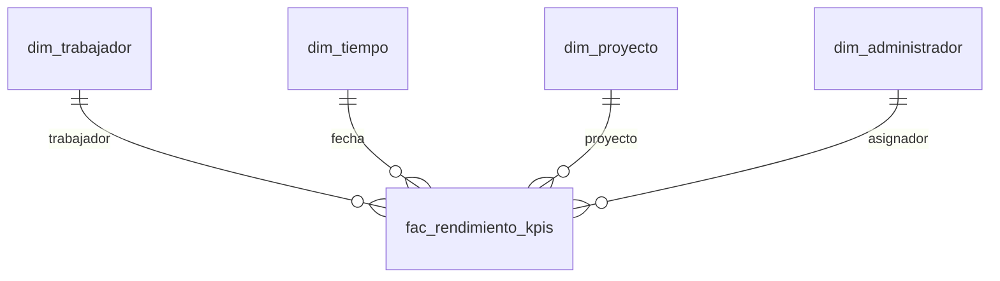

# Modelo estrella y reglas de transformación

## Origen y alcance

El origen contiene `Empleados`, `Trabajadores`, `Administrador`, `Roles_Sistema`, `Proyectos`, `Asistencia`, `Tareas`, `Actividades`, `Archivos`, `Comentarios_Tarea` y `Evaluaciones_Rendimiento`. El ETL utiliza las siete primeras para identificar personas, interpretar jornadas y medir asistencia y tareas. Las otras tablas se conservan en el esquema; el generador inicial no les carga movimientos y no se inventan indicadores de ellas.

Los diez trabajadores se identifican por los ID 1, 2, 3, 4, 6, 7, 8, 9, 10 y 11. Benjamin Alfonso, Israel y Matías son practicantes. El personal restante es regular. El ID 5 corresponde al administrador. Carlos Mendoza, ID 10, es un nombre de referencia del conjunto simulado y debe confirmarse si se sustituye por información real.

## Grano y relaciones

Una fila de `fac_rendimiento_kpis` representa **trabajador + fecha + proyecto + administrador**. Cada dimensión tiene una clave interna; las dimensiones de personas y proyectos conservan también el identificador del origen. La combinación de las cuatro claves es única.

La asistencia no tiene proyecto ni administrador en el origen. Se carga una sola vez por persona y fecha con ambas claves en cero. Las tareas se agrupan por trabajador, fecha de asignación, proyecto y administrador reales; sus medidas de asistencia se mantienen en cero. Así, varias tareas o proyectos en una jornada no multiplican las asistencias.

Las filas de calendario sin marca de entrada también usan proyecto y administrador cero. Al filtrar un proyecto real se pueden analizar tareas, pero no atribuirle puntualidad ni IEP: el origen no ofrece esa relación. El reporte de rendimiento general utiliza trabajador y tiempo; el reporte de proyectos utiliza métricas de tareas.

Las dimensiones se actualizan por sustitución de atributos, sin conservar versiones históricas. Si cambia un cargo o una jornada, este modelo no reconstruye su historia anterior. Es una limitación del alcance T2.

## Extracción, limpieza y carga

1. El intervalo se valida y queda registrado en `bitacora_etl`. Se rechazan fechas nulas, invertidas o intervalos superiores a 3.660 días.
2. Un bloqueo de aplicación evita dos cargas simultáneas. No se permite ejecutar el procedimiento dentro de una transacción externa.
3. Se leen trabajadores, roles, empleados, proyectos y administradores. Se eliminan espacios al inicio y al final de los textos. Un trabajador sin código o nombre impide la carga.
4. Se actualizan las dimensiones y se completa el calendario, con nombres de meses y días en español, independientes del idioma de la sesión.
5. Se extraen asistencias por fecha de entrada y tareas por fecha de asignación. Los estados se normalizan a mayúsculas para evaluarlos y las observaciones vacías se convierten en `NULL`.
6. Se registran en `rechazos_etl` las referencias inexistentes, salidas anteriores a la entrada, estados de tarea desconocidos y fechas de inicio o entrega incoherentes. Una tarea completada debe tener fecha de entrega; una pendiente no puede tenerla.
7. Se recalculan las medidas de los registros aceptados. Los datos rechazados no se corrigen ni se borran del origen.
8. Se reemplazan los hechos del intervalo y se registra la cantidad extraída, rechazada y cargada. Un error revierte la carga y queda como `Fallida`; si hay rechazos, la carga termina como `Con rechazos` y el reporte representa únicamente los registros aceptados.

Para corregir datos tardíos o estados de tareas, volver a ejecutar el intervalo que contiene su **fecha de asignación**, aunque la entrega haya ocurrido después. La carga no es incremental por fecha de última modificación: el origen no posee ese campo.

La transacción protege la escritura en el destino. No se afirma una instantánea consistente de todo el origen frente a cambios concurrentes. Para la demostración, mantener el conjunto de entrada sin modificaciones durante la carga.

## Diccionario de indicadores

| Indicador | Cálculo | Interpretación y límite |
| --- | --- | --- |
| TPA | A tiempo / asistencias válidas × 100 | Hasta 09:40:59 es a tiempo; desde 09:41:00 es tardanza. |
| ICT | Completadas sin observaciones / tareas válidas × 100 | Convención académica de aceptación; no existe un campo de aprobación formal. |
| TDT | Tareas con `FUERA DE PLAZO` en observaciones / tareas válidas × 100 | Identifica también el texto `[ENTREGADO FUERA DE PLAZO]`. No se deduce un vencimiento inexistente. |
| IEP | TPA × 0,30 + ICT × 0,50 + (100 − TDT) × 0,20 | Puntaje de 0 a 100, sin equivalencia monetaria definida. |
| Finalización | Completadas / tareas válidas × 100 | Incluye completadas con correcciones o fuera de plazo. |
| Corrección | Tareas con observaciones sin `FUERA DE PLAZO` / tareas válidas × 100 | La clasificación distingue corrección de entrega tardía. |
| Pendientes | Asignadas + en progreso | Estado actual de las tareas del período de asignación. |
| Tardanza | Tardanzas / asistencias válidas × 100 | Complemento de TPA. |
| Minutos de tardanza | Minutos por encima de 09:40 en las entradas clasificadas tarde | Se redondea hacia arriba cada fracción de minuto. No son descuentos salariales. |
| Permanencia | Suma de salida − entrada en horas | Sin descontar almuerzo, pausas u horas extra. Salidas nulas aportan cero y se cuentan aparte. |
| Jornadas sin marca | Jornadas programadas sin asistencia válida | No acredita falta injustificada: pueden existir vacaciones, feriados, licencias o datos rechazados. |
| Cobertura de marcas | (Jornadas esperadas − jornadas sin marca) / jornadas esperadas × 100 | Se basa en el calendario académico L–V o L–M–V. |

El calendario esperado supone que los diez trabajadores pertenecieron al proyecto durante todo el intervalo. No descuenta feriados ni interpreta el estado actual como historial contractual: faltan fechas de alta/baja y un calendario de licencias. La puntualidad se vuelve a calcular a partir de la hora, sin depender de una etiqueta previamente almacenada.

Cuando un denominador es cero, el KPI queda en `NULL` en SQL y vacío en Power BI. El IEP también queda vacío si falta algún componente. Para comparar un trimestre se suman numeradores y denominadores y se recalculan las tasas; no se promedian porcentajes mensuales.

La tabla de hechos conserva cantidades aditivas. El ETL calcula los numeradores, denominadores y banderas; las vistas y las medidas DAX calculan las tasas para el período seleccionado. Guardar únicamente porcentajes diarios produciría agregaciones incorrectas.

## Condiciones del conjunto simulado

Los porcentajes se aplican al trimestre, con redondeo al entero más cercano. Benjamin tiene 38 de 40 entradas dentro de su franja principal y 38 de 40 tareas completadas sin observaciones. Israel tiene 24 de 40 entradas tardías y 20 de 40 tareas completadas con el marcador de entrega fuera de plazo. Matías tiene 20 de 40 entradas a las 09:30 y 20 a las 09:45.

Los regulares tienen todas sus entradas entre 08:45 y 09:35 por la regla del generador. Por tanto, su TPA resulta 100%, aunque sus franjas de ingreso y sus tareas sean diferentes. Benjamin tiene TPA de 95%; no corresponde afirmar que tiene el mayor TPA de todo el conjunto. Se conserva esta regla ya ejecutada en el origen y se documenta su efecto en la presentación.

No se calculan remuneración, absentismo legal, productividad por complejidad, aprobación formal ni desviación frente a una fecha límite contractual: faltan sueldo, contrato, esfuerzo de la tarea, aprobación y vencimiento explícito. Estos datos deben incorporarse con reglas confirmadas antes de usar el modelo para pagar remuneraciones.
