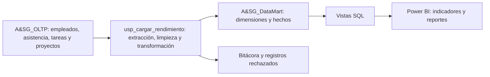

# Rendimiento del personal — Construct&Lex / A&SG SAC

Proyecto académico de Inteligencia de Negocios para analizar asistencia y cumplimiento de tareas de diez trabajadores durante julio, agosto y septiembre de 2026. La solución separa el registro operativo del análisis: SQL Server almacena el origen, un procedimiento ETL carga el Data Mart y Power BI consulta sus vistas.

El esquema transaccional procede del material proporcionado para el caso. Los registros históricos de este repositorio son simulados; no constituyen una exportación de operaciones reales ni una planilla pagada por la empresa.

## Arquitectura



## Requisitos

- SQL Server 2016 SP1 o posterior; se recomienda SQL Server 2022 o 2025 Developer para el trabajo académico.
- SQL Server Management Studio y Power BI Desktop en Windows.
- Ambas bases en la misma instancia de SQL Server.
- Para instalar: permisos de creación de bases, tablas, procedimientos y vistas. Para ejecutar el ETL: lectura del origen y escritura en el Data Mart. Usar una cuenta de solo lectura para Power BI cuando se configure el acceso definitivo.

## Ejecución desde cero

Descargar el repositorio con **Code → Download ZIP**, descomprimirlo y abrir los archivos en SSMS. Ejecutar cada archivo completo con F5, en este orden:

| Orden | Archivo | Resultado |
| --- | --- | --- |
| 1 | `01_Base_Datos/01_Estructura_y_Datos.sql` | Crea `A&SG_OLTP`, doce tablas y los datos del trimestre. |
| 2 | `01_Base_Datos/02_Creacion_Data_Mart.sql` | Crea `A&SG_DataMart`, cuatro dimensiones, hechos y auditoría. |
| 3 | `02_Procedimientos_Almacenados/02_Procedimiento_ETL.sql` | Crea o actualiza `dbo.usp_cargar_rendimiento`. |
| 4 | `03_Vistas_PowerBI/03_Vistas_PowerBI.sql` | Crea o actualiza las vistas de consulta. |
| 5 | `04_Documentacion/01_Validacion_ETL.sql` | Ejecuta dos cargas, verifica idempotencia y concilia origen y destino. |

Si el origen ya está creado con el primer archivo, continuar desde el segundo. Los scripts no contienen rutas a archivos `.mdf` de otra computadora. Los nombres de las bases contienen `&` y se escriben entre corchetes en T-SQL.

Para actualizar solo un período ya instalado:

```sql
USE [A&SG_DataMart];
GO
EXEC dbo.usp_cargar_rendimiento
	@fecha_desde = '20260701',
	@fecha_hasta = '20260930';
GO
SELECT * FROM dbo.vw_indicadores_mensuales
ORDER BY id_trabajador_origen, mes;
SELECT * FROM dbo.vw_calidad_cargas ORDER BY id_carga DESC;
```

El procedimiento reemplaza únicamente los hechos del intervalo indicado, dentro de una transacción. Repetirlo no debe duplicar las medidas; sí genera una nueva entrada en la bitácora. Cargar el trimestre completo para que Power BI muestre los tres meses.

## Resultados de referencia del conjunto inicial

| Período | Asistencias | Tareas |
| --- | ---: | ---: |
| Julio de 2026 | 203 | 203 |
| Agosto de 2026 | 186 | 186 |
| Septiembre de 2026 | 193 | 193 |
| Total | 582 | 582 |

Hay diez trabajadores: siete regulares con 66 jornadas cada uno y tres practicantes con 40 cada uno. El empleado 5 es el administrador, por eso no aparece como trabajador. Se esperan 92 fechas, tres proyectos reales más el miembro técnico de asistencia, un administrador real más el miembro técnico y 30 resúmenes de trabajador y mes. Con una tarea por jornada, los hechos contienen 1.164 filas: 582 de asistencia y 582 agrupaciones de tareas. No confundir filas de hechos con cantidad de asistencias.

Estos valores son referencias calculadas a partir del generador. Las evidencias de ejecución en SSMS y Power BI deben adjuntarse después de ejecutar los scripts; no están sustituidas por esta tabla.

Los scripts también se ejecutaron en una instancia aislada de SQL Server 2022 Developer. Se verificaron las cantidades, la repetición del ETL y los controles de calidad. Los resultados están en [Evidencias/01_Resultados_SQL_Server.txt](04_Documentacion/Evidencias/01_Resultados_SQL_Server.txt); las capturas de SSMS del equipo y el informe `.pbix` siguen pendientes.

## Documentación y entregables

- [Modelo estrella y reglas de datos](04_Documentacion/02_Modelo_y_Reglas.md).
- [Conexión y construcción de reportes en Power BI](04_Documentacion/03_Guia_PowerBI.md).
- [Evidencias y demostración de diez minutos](04_Documentacion/04_Evidencias_y_Demostracion.md).
- [Historial de cambios](04_Documentacion/05_Registro_Cambios.md).
- [Medidas DAX](03_Vistas_PowerBI/04_Medidas_PowerBI.dax).

El IEP permite comparar rendimiento. El cálculo de remuneraciones en soles queda pendiente de contar con sueldos base, jornadas contractuales, regla de bonificación y aprobación de la empresa. Las horas de permanencia no son, por sí solas, horas pagables.

## Colaboración en GitHub

Cada integrante debe trabajar con su propia identidad de Git y documentar los cambios que realizó. Las ramas `feature/` se comparan contra `main` mediante pull requests. Registrar en el historial los archivos cambiados, las validaciones realizadas y las limitaciones. Revisar el pull request antes de integrar los cambios a `main`.
